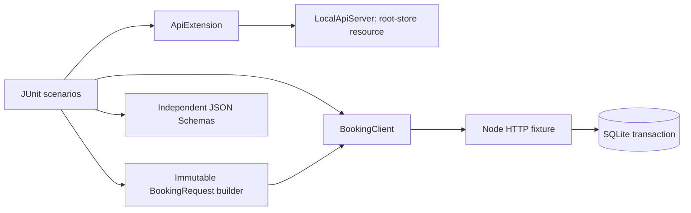

# Architecture and decisions

## ADR 001 — REST client as an adapter

The client owns request construction, URL paths and authentication; tests own assertions. A fresh request specification is created for every call. REST Assured static configuration is never mutated. The request builder returns an immutable record; each default builder gets a unique room.

## ADR 002 — JUnit owns infrastructure

The extension stores one AutoCloseable server in the root ExtensionContext store. Startup reads a machine-readable port with a deadline; stderr goes to a file. Port 0 avoids fixed-port collisions. Teardown destroys the process and escalates to forcible termination if it does not exit.

The database starts empty for every test plan. Tests use unique room identifiers and keys, so the suite can run in parallel without global reset endpoints. Alice and Bob are synthetic identities used to verify access boundaries.

## ADR 003 — SQLite and atomic booking

A confirmed booking overlaps when `existing.start < requested.end AND existing.end > requested.start`. This defines half-open intervals: checkout and the next check-in can share a date.

The idempotency lookup, availability check, insert and response snapshot are inside one BEGIN IMMEDIATE transaction. Cancellation changes status; it preserves history while freeing availability.

SQLite and synchronous calls keep setup portable. This single-process implementation is deliberately simpler than a distributed booking system; concurrency tests verify its HTTP behavior, not multi-node locking.

## ADR 004 — Idempotency semantics

A key is scoped to the caller. The first valid request returns 201; an identical replay returns 200 with the original response snapshot. A changed payload returns 409. Inputs are canonicalized by named fields, so JSON object ordering is irrelevant.

A replay after cancellation returns the original create response. GET returns the current cancelled state. Replaying never creates a new booking. In production, retention and expiry of keys would need a separate policy.

## ADR 005 — Independent oracles

Response schemas live in test resources, not generated from service output. Tests assert business effects in addition to schema/status: count resources after concurrent writes, read state after cancellation, verify owner isolation, and check rejected inputs did not create data.

The API contract describes the intended behavior. Both the fixture and tests are educational code in this repository; adapting to an independently maintained application is a useful next step.
